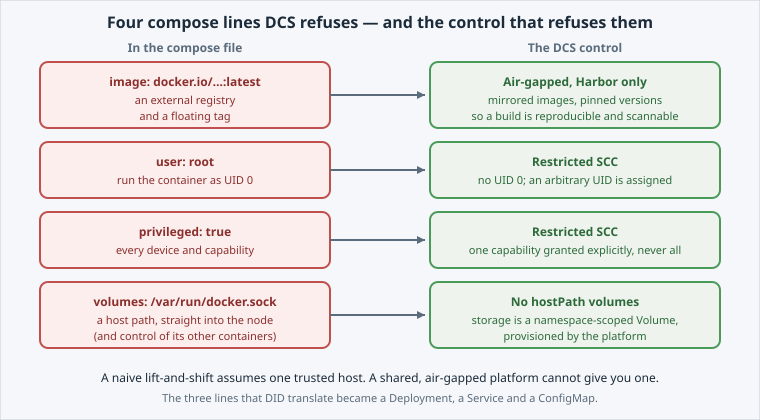

Three compose lines mapped cleanly onto a Deployment, a Service and a ConfigMap.

Four lines did **not** make it into any manifest you applied, because
 refuses them. These constraints affect how you build images, so they
matter more than the mapping.

Open the slide for this page (📊 **Slides** tab):

```dashboard:reload-dashboard
name: Slides
url: :///slides/#/rejected
```

Look at what is left over in the compose file:

```editor:open-file
file: ~/exercises/docker-compose.yml
```



## `image: docker.io/rummens/hello-dcs:latest`

This line has two separate problems.

**Not from Harbor.**  is **air-gapped**, so `docker.io` is
unreachable from inside the platform. Every image must already be mirrored into
[Harbor](/services/container-registry), which is why page 02
pulled from ``. An image that is not mirrored yet is requested,
not pulled ad hoc.

**The floating tag.** A [tag](https://kubernetes.io/docs/concepts/containers/images/#image-names)
like `latest` means the same manifest can quietly start a *different* image tomorrow. That
deployment cannot be reproduced, and the image cannot be scanned as a known artifact.
 wants a pinned version, or better a digest. `hello-dcs:1.0` is
the pinned version.

## `user: root`

Docker containers run as root unless told otherwise.  enforces a
**restricted** [Security Context Constraint](https://docs.redhat.com/en/documentation/openshift_container_platform/latest/html/authentication_and_authorization/managing-pod-security-policies):

- no container may run as **UID 0**;
- every container must tolerate an **arbitrary non-zero UID** assigned at deploy time.

`hello-dcs` already runs as UID 1001 for that reason. There is nothing to fix in the
manifest: this is a property of the **image** you choose.

## `privileged: true`

A [privileged container](https://kubernetes.io/docs/tasks/configure-pod-container/security-context/)
gets root-equivalent access to the node: every device, every kernel capability.

The restricted SCC blocks it outright. If a workload needs one specific capability, that
capability is granted explicitly. Full privileged mode is not granted.

## `volumes: - /var/run/docker.sock:/var/run/docker.sock`

This is a **host bind mount** into the node's own filesystem. In this case it is the Docker
socket, which would hand the container control of every other container on that node.

Kubernetes has no "the host's files" concept for an ordinary workload. Storage is a
namespace-scoped [Volume](https://kubernetes.io/docs/concepts/storage/volumes/), backed by a
[PersistentVolumeClaim](https://kubernetes.io/docs/concepts/storage/persistent-volumes/) the
platform provisions. The restricted SCC rejects `hostPath` for the same reason it rejects
`privileged`.

## See the constraint for yourself

The cluster enforces the SCC on every Pod. Ask which SCC admitted your own workload:

```terminal:execute
command: oc get pod -l app=hello-dcs -o jsonpath='{.items[0].metadata.annotations.openshift\.io/scc}{"\n"}'
```

```section:begin
name: breakdown-read-scc-annotation
prefix: Breakdown
title: What each part of the command does
```

- **`oc get pod -l app=hello-dcs`** — selects the Pods with the label `app=hello-dcs`.
- **`-o jsonpath='…'`** — prints one field instead of the table.
- **`.items[0]`** — the first Pod in that list.
- **`.metadata.annotations.openshift\.io/scc`** — the annotation OpenShift adds to record which SCC admitted the Pod. The `\.` escapes the dot in the annotation name, so it is not read as a path separator.
- **`{"\n"}`** — adds a newline so your prompt starts on its own line.

```section:end
name: breakdown-read-scc-annotation
```

That prints the SCC the running Pod was admitted under. `restricted-v2` is the one described
above.

```examiner:execute-test
name: verify-scc-restricted
title: Verify the running Pod was admitted under a restricted SCC
timeout: 10
retries: 3
delay: 2
```

All four lines assume a single host that you control. On an air-gapped, multi-tenant
platform you do not control the host, so the platform refuses them.
