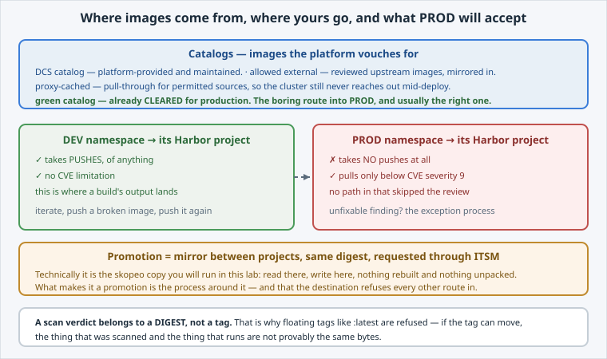

Three rules govern what you may pull and push. The third one is the one people are
surprised by.

Open the slide for this page (📊 **Slides** tab):

```dashboard:reload-dashboard
name: Slides
url: :///slides/#/rules
```



## 1. Catalogs: where images come from

 does not let a cluster pull from wherever a manifest points. Images
come from catalogs the platform curates:

- **the DCS catalog:** platform-provided images, mirrored and maintained.
- **allowed external:** upstream images that have been reviewed and mirrored in. This is a
  list, not "anything on the internet".
- **proxy-cached:** a pull-through cache for permitted sources, so the cluster still never
  reaches out mid-deploy.
- **the green catalog:** images already **cleared** for production use, meaning somebody has
  signed off on them.

## 2. Projects: where *your* images go

A tenant may be given a **Harbor project of its own**. It is optional, and scoped **per
namespace** today. A per-tenant model is the direction; the mapping is per-namespace for
now.

That project is where a build's output lands, and where your team's images live.

## 3. The asymmetry: DEV pushes, PROD does not

This is the rule to remember:

- **A DEV namespace's project takes pushes**, of anything, with no CVE limitation. That is
  what DEV is for: iterate, push a broken image, push it again.
- **A PROD namespace's project takes no pushes at all**, and it pulls only images whose
  vulnerabilities are **below CVE severity 9**.

You therefore cannot build straight into production. It is not blocked after the fact; there
is no route.


**📌 If an image genuinely cannot meet the threshold**, for example an unfixable finding in
a dependency you need, there is a **security exception process**. It is a conversation with a
decision at the end, not a flag you set.


## Prove the pull path works

```terminal:execute
command: envsubst < pod-from-registry.yaml | oc apply -f - && oc wait --for=condition=Ready pod/from-registry --timeout=180s
```

```examiner:execute-test
name: verify-pull-works
title: Verify your namespace can pull and run a registry image
timeout: 180
retries: .INF
delay: 5
```

That is every other lab's first step, seen as what it is: a **pull** from a registry your
namespace is allowed to pull from.

Next, look at an image without running it at all.
