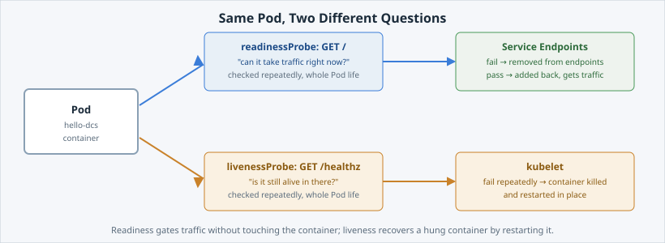

Without probes,  cannot tell whether a container works, even
when it is correctly sized: it sends traffic to a hung container, or keeps a slow-starting one out of
rotation.

**Probes** are how a Pod answers two different questions the platform keeps asking.

Open the slide for this page (📊 **Slides** tab):

```dashboard:reload-dashboard
name: Slides
url: :///slides/#/probes
```

## Two different questions



- **Readiness asks "can you take traffic right now?"** Fail it and the Pod is pulled out of
  the Service's **endpoints**. No traffic reaches it, and the container is left alone. Pass
  again and traffic resumes. Nothing restarts.
- **Liveness asks "are you still alive in there?"** Fail it repeatedly and the **kubelet**
  kills the container and starts a fresh one in the same Pod. That is for a container which
  is running but permanently stuck, which readiness alone cannot fix.


**📌 Note:** there is a third kind, a [startup probe](https://kubernetes.io/docs/tasks/configure-pod-container/configure-liveness-readiness-startup-probes/#define-startup-probes),
for apps that need a long time to boot. It holds liveness off until the app has started once,
so a slow start is not mistaken for a hang.


## Read the probes you already applied

`deployment-probes.yaml`, the file from the last page, carries both: readiness on `/`, and
liveness on the app's dedicated `/healthz`.

```terminal:execute
command: oc describe deployment hello-dcs
```

Near the bottom of the output, the `Readiness:` and `Liveness:` lines name each probe's HTTP
path, port and timing (`initialDelaySeconds`, `periodSeconds`, `failureThreshold`).

```examiner:execute-test
name: verify-probes-configured
title: Verify hello-dcs has both a readiness and a liveness probe
timeout: 10
retries: 3
delay: 2
```

## Ready means "in the endpoints"

A Pod that passes readiness is added to its Service's endpoint list, which is the set of
addresses the Service sends traffic to:

```terminal:execute
command: oc get endpoints hello-dcs
```

```examiner:execute-test
name: verify-endpoints-ready
title: Verify the Service has ready Pods in its endpoints
timeout: 15
retries: .INF
delay: 2
```

Four `IP:8080` pairs, one per ready Pod. That list is exactly what readiness controls.

## Break readiness on purpose

Watch the Pods in the **lower** pane while you do this. `-o wide` adds the NODE and IP
columns, and `timeout 60` stops the watch by itself:

```terminal:execute
command: timeout 60 oc get pods -o wide -l app=hello-dcs --watch
session: 2
```

```section:begin
name: breakdown-watch-pods
prefix: Breakdown
title: What each part of the command does
```

- **`timeout 60`** — stops the command after 60 seconds, so nothing is left running in the pane.
- **`oc get pods`** — lists Pods.
- **`-o wide`** — adds columns such as the Pod IP and the node it runs on.
- **`-l app=hello-dcs`** — shows only Pods with the label `app=hello-dcs`.
- **`--watch`** — keeps the command running and prints a new line each time a Pod changes.

```section:end
name: breakdown-watch-pods
```

In the **upper** pane, point readiness at a path that does not exist. `oc set probe` edits a
running Deployment's probes directly, with no manifest edit:

```terminal:execute
command: oc set probe deployment/hello-dcs --readiness --get-url=http://:8080/this-path-does-not-exist
```

That is a template change, so one replacement Pod rolls out at a time. The new Pod starts,
fails its readiness check every few seconds, and never becomes Ready, so it is never added to
the endpoints.

In the lower pane, one Pod's READY column sits at `0/1` while the others stay `1/1`.

```examiner:execute-test
name: verify-readiness-broken
title: Verify one Pod is held out of rotation by the broken readiness probe
timeout: 20
retries: .INF
delay: 3
```

Check the endpoints again:

```terminal:execute
command: oc get endpoints hello-dcs
```

```examiner:execute-test
name: verify-endpoints-reduced
title: Verify the broken Pod was removed from the Service endpoints
timeout: 20
retries: .INF
delay: 3
```

The list now has one address fewer. The Pod that fails readiness gets no traffic, the
others keep serving, and nothing is restarted.

## Restore it

```terminal:execute
command: envsubst < deployment-probes.yaml | oc apply -f -
```

```section:begin
name: breakdown-restore-probes
prefix: Breakdown
title: What each part of the command does
```

- **`envsubst < deployment-probes.yaml`** — reads the manifest and replaces `${DCS_REGISTRY}` with the registry address from your session.
- **`| oc apply -f -`** — the pipe hands the result to `oc apply`. The `-f -` means "read the manifest from the pipe" instead of from a file.

```section:end
name: breakdown-restore-probes
```

```examiner:execute-test
name: verify-readiness-restored
title: Verify readiness is restored and all replicas are ready again
timeout: 30
retries: .INF
delay: 2
```

All four addresses are back.

The liveness probe never came into play. The container was running and answering the whole
time, just not on the path readiness was pointed at. Liveness only acts when the container
stops answering **anything**, and it recovers by restarting rather than by routing around.
