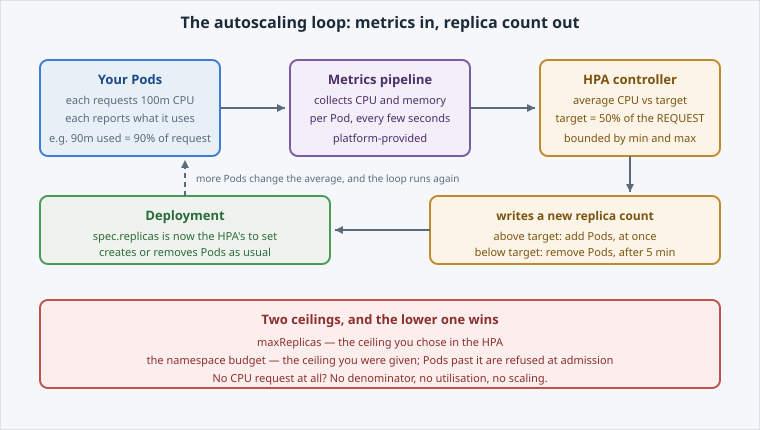

An HPA is a controller that checks the metrics again every few seconds.

Every few seconds it asks the same question: given what these Pods are using, how many of
them should there be?

Open the slide for this page (📊 **Slides** tab):

```dashboard:reload-dashboard
name: Slides
url: :///slides/#/hpa-loop
```

## The loop



1. The platform's **metrics pipeline** collects CPU and memory use per Pod.
2. The **HPA controller** reads it, and averages CPU across the Pods it owns.
3. It compares that average with its **target**.
4. It writes a new **replica count** onto the Deployment, which then creates or removes
   Pods exactly as if you had run `oc scale` yourself.

## Requests are the denominator

The target is a **percentage of the Pod's CPU request**, not of a core:

- Each Pod requests **100m** CPU (a tenth of a core).
- The HPA targets **50%** utilisation, so **50m** per Pod.
- Four Pods averaging 90m are at 180% of target, so the HPA scales out.

That is why **Health & Resources** comes first. With **no** CPU request there is nothing to
take a percentage *of*, so the HPA reports `<unknown>` and never scales.


**⚠️ Watch out:** requests are also what the scheduler and your namespace quota count. Set
them too high and the HPA scales out later than you expect, while each replica spends more of
the budget.


## What it does not do

- It does **not** make a slow app fast. It adds copies of the same app.
- It does **not** help a workload that is slow for a reason other than CPU, unless you give
  it the metric that reflects the real bottleneck.
- It does **not** exceed `maxReplicas`, and it cannot beat the namespace budget.

The next page creates one.
