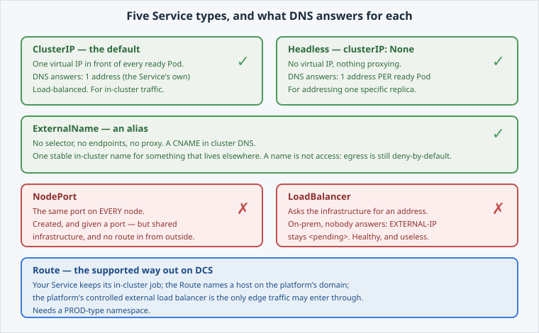

Every Service has a **selector** (which Pods) and **ports** (which port). The `type` decides
what the platform builds around that.

Open the slide for this page (📊 **Slides** tab):

```dashboard:reload-dashboard
name: Slides
url: :///slides/#/types
```



## The five

- **ClusterIP** gives one stable virtual IP, load-balanced across ready Pods. It is the
  default, and what you want for in-cluster traffic.
- **Headless** (`clusterIP: None`) has no virtual IP. DNS returns **one record per ready
  Pod** and the client picks, which is what a client that must address a *specific* replica
  needs.
- **ExternalName** has no selector, no endpoints and no proxying. It is a **CNAME** in cluster
  DNS, so one stable in-cluster name can point at something that lives elsewhere.
- **NodePort** opens the same port on **every node** in the cluster.
- **LoadBalancer** asks the infrastructure for an external address, and needs a provider that
  answers.

## What that means here

On  you use the first three. The last two exist in the API and you
can create them, but:

- a **NodePort** puts a port on shared nodes, outside your tenant boundary, and nothing from
  outside is allowed to reach a node directly. The platform's **controlled external load
  balancer** is the only edge, and that is a security requirement;
- a **LoadBalancer** has no provider to answer it on an on-prem cluster, so it never gets an
  address.

The supported way out is a [**Route**](/concepts/networking),
which the Core **Expose Your App** lab covers, and which needs a **PROD-type** namespace.


**💡 Tip:** you apply both of those types yourself on the last page and read what
happens.


Next, the default type, and what DNS returns for it.
