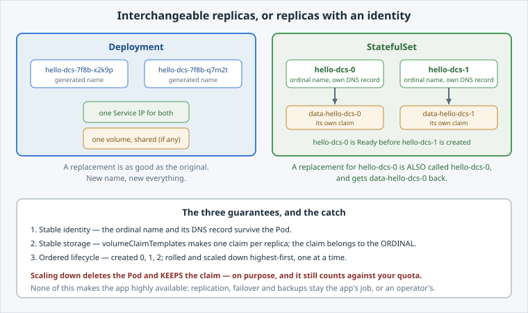

<!-- Edit this file: one slide per line of three dashes. Give a slide a deep-link id with an id-comment on its own line. Markdown: headings, - lists, **bold**, `code`, fenced code, , [text](url). -->

<!-- id: intro -->
# Stateful Workloads

A Deployment's replicas are interchangeable. A database replica is not: it needs the same name and the same disk back.

**In this lab:** identity vs interchangeability · build a StatefulSet · per-Pod DNS and per-replica data · survive a delete · what scaling leaves behind.

Digital Container Service · DCS Academy

---

<!-- id: identity -->
## Why a StatefulSet

A Deployment can mount a volume too. Use a StatefulSet when each replica must be **distinguishable** from the others.

- **Stable identity** — `hello-dcs-0`, and the replacement is `hello-dcs-0` too.
- **Stable storage** — one claim per replica, bound to the **ordinal**, not the Pod.
- **Ordered lifecycle** — 0 Ready before 1 exists; rollouts and scale-down go highest-first, one at a time.
- Not a database: replication and failover stay the app's job, or an operator's.



---

<!-- id: build -->
## Build one

A headless Service first, because that is where the per-Pod DNS names come from, then the StatefulSet that names it.

```
oc apply -f service-headless.yaml
envsubst < statefulset.yaml | oc apply -f -
oc get pods,pvc -l app=hello-dcs
```

- `serviceName` — the headless Service providing the names.
- `volumeClaimTemplates` — `data-hello-dcs-0`, `data-hello-dcs-1`, one per replica.
- Watch what you do **not** see: both Pods starting at once.
- Slower than a Deployment of two: each volume is provisioned and each Pod becomes Ready before the next starts.

---

<!-- id: dns -->
## A name and a disk each

Each replica answers to its own DNS name, and writes to its own volume.

```
getent hosts hello-dcs-0.hello-dcs.$(oc project -q).svc.cluster.local
oc exec hello-dcs-0 -- sh -c 'echo "written by $HOSTNAME" \
  > /opt/app-root/src/data/owner.txt'
```

- The per-Pod name resolves to **that Pod's** address, so a client can connect to replica 0 specifically.
- Each replica reads back its own marker, so the volumes are separate.
- `fsGroup: 1001` is what lets a non-root process write a freshly provisioned volume.

---

<!-- id: restart -->
## Survive a restart

Delete replica 0 and watch what comes back.

```
oc delete pod hello-dcs-0
oc exec hello-dcs-0 -- cat /opt/app-root/src/data/owner.txt
```

- Same **name** and DNS record. A Deployment would create a Pod with a new name.
- A **new** Pod, though, with a different UID.
- The marker is still there because the claim was never deleted.
- The claim belongs to the ordinal, so `hello-dcs-0` gets `data-hello-dcs-0` back.

---

<!-- id: scaling -->
## Scaling, and what it leaves

Scaling up creates a new claim. Scaling down keeps the old one.

```
oc scale statefulset/hello-dcs --replicas=3   # new Pod + new claim
oc scale statefulset/hello-dcs --replicas=2   # Pod gone, claim stays
oc get pvc
```

- The highest ordinal goes first, so `hello-dcs-2` is the one removed.
- `data-hello-dcs-2` stays `Bound`: scale back up and the data is there.
- Deleting a volume is irreversible, so it is never a side effect of a replica count.
- The kept claim still counts against your **storage quota** until someone deletes it.
- Deleting the StatefulSet behaves the same: cleanup is **two** deletions.

---

<!-- id: next -->
## What's next

Each replica now has a stable name, its own volume and a start order, which a clustered app needs.

**Next lab, Short-Lived & Helper Containers:** the other shapes. **Jobs** and **CronJobs** that run to completion, **init containers** that must finish first, and **sidecars** that run alongside.

Digital Container Service · DCS Academy
