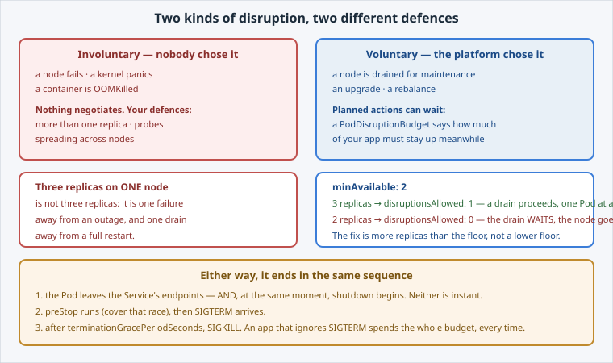

<!-- Edit this file: one slide per line of three dashes. Give a slide a deep-link id with an id-comment on its own line. Markdown: headings, - lists, **bold**, `code`, fenced code, , [text](url). -->

<!-- id: intro -->
# Resilience & Scheduling

The platform moves your Pods during drains, upgrades and rebalancing. This lab shows how to limit that and shut down cleanly.

**In this lab:** two kinds of disruption · a PodDisruptionBudget · timing a real shutdown · spreading replicas.

Digital Container Service · DCS Academy

---

<!-- id: disruption -->
## Two kinds of disruption

They need different answers, and only voluntary disruption can be delayed.

- **Involuntary** — a node fails, a container is OOMKilled. Defences: replicas, probes, spreading.
- **Voluntary** — a drain, an upgrade, a rebalance. Planned, so it can **wait**: that is what a PDB is for.
- On DCS you never run the drain. Your budget sets the limit the platform's drains must respect.
- Both paths end in the same shutdown sequence.



---

<!-- id: pdb -->
## A budget for maintenance

The useful part of a PDB is its **status**, and it is easy to miss.

```
oc apply -f pdb.yaml
oc get pdb hello-dcs -o custom-columns=\
MIN:.spec.minAvailable,ALLOWED:.status.disruptionsAllowed,\
HEALTHY:.status.currentHealthy,EXPECTED:.status.expectedPods
```

- **disruptionsAllowed** — how many Pods the platform may take **right now**.
- 3 replicas, floor of 2 → **1**: a drain proceeds one Pod at a time.
- Scale to 2 → **0**: the drain waits, and the node goes unpatched.
- If nobody can satisfy the budget, maintenance stalls until someone overrides it.
- The fix is **more replicas than the floor**.

---

<!-- id: shutdown -->
## Shutting down well

Deleting a Pod runs a sequence of steps, and two of them race.

```
pod=$(oc get pods -l app=hello-dcs -o name | head -1)
start=$(date +%s); oc delete "$pod"; end=$(date +%s)
echo $(( end - start ))
```

- Endpoint removal and shutdown start **together**; neither is instant.
- `preStop` pauses before SIGTERM, covering that race.
- `terminationGracePeriodSeconds` is the total budget — preStop comes out of it.
- Ours takes the **full 30s**: hello-dcs ignores SIGTERM, so the kubelet SIGKILLs it.
- An app that handles SIGTERM exits early. That behaviour comes from the image; the manifest cannot add it.

---

<!-- id: spread -->
## Spreading replicas

If all three replicas run on one node, one node failure takes the app down. The scheduler packs by default, because it optimises for cluster use rather than for your availability.

```
topologySpreadConstraints:
- maxSkew: 1
  topologyKey: kubernetes.io/hostname
  whenUnsatisfiable: ScheduleAnyway
```

- `ScheduleAnyway` — a **preference**: better placement when possible, never a stuck Pod.
- `DoNotSchedule` — a **requirement**: guaranteed spread, and Pending Pods when it cannot be met.
- On a single-node cluster everything lands together, and ScheduleAnyway is why it still runs.
- Hard spreads interact with quota and free capacity: read `oc describe pod` before blaming the platform.

---

<!-- id: next -->
## What's next

That is the Build & Run track: an app built on the cluster, sized, autoscaled, reachable, stateful where it has to be, and able to survive maintenance.

**Operate & Observe** takes it from here: metrics and logs for the app you just made resilient, the tenancy and RBAC model underneath it, and the DEV to PROD promotion path.

Digital Container Service · DCS Academy
