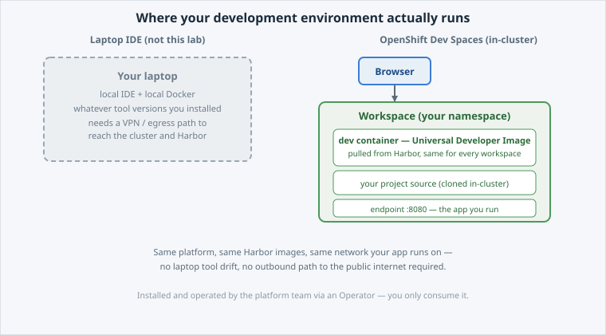

Every lab so far has run your `oc` commands from the **Educates terminal**, which is a
shell rather than a development environment. [OpenShift Dev
Spaces](https://developers.redhat.com/products/openshift-dev-spaces/overview), built on the
upstream [Eclipse Che](https://eclipse.dev/che/docs/stable/overview/introduction-to-eclipse-che/)
project, is a full browser-based IDE with an editor, terminal, debugger and extensions,
running as a workspace **inside the cluster** next to the code it edits.

Open the slide for this page (📊 **Slides** tab):

```dashboard:reload-dashboard
name: Slides
url: :///slides/#/what
```

## Why an in-cluster IDE

A laptop IDE means every developer's environment is whatever they happened to install:
different tool versions, different OS behaviour, and on an air-gapped platform a laptop that
cannot reach Harbor or the cluster network the way a workspace inside the platform can.

Dev Spaces removes that variance. Every workspace starts from the same image, has direct
access to the cluster it develops for, and never needs an outbound connection to fetch a
plugin or a dependency.

Who provides it matters too. Dev Spaces is
[operator](https://kubernetes.io/docs/concepts/extend-kubernetes/operator/)-installed and run
by the DCS platform team. You do not install it, upgrade it or manage its lifecycle, in the
same way that you do not manage the cluster it runs on. You open the tab, launch a workspace
and develop. See the
[ Dev Spaces service](/services/dev-spaces)
for how your tenant gets access.



## What a workspace actually is

A **workspace** is a set of containers running in your namespace — one of them is
your dev environment (a full toolchain image), with your project's source code
cloned into a shared volume so every container in the workspace can see it. You
reach it entirely through the browser: no SSH key, no VPN, no local `git clone`. When you
close the tab the workspace keeps running, or stops, depending on configuration. The code
lives in the cluster rather than on your machine.

## What defines a workspace

A workspace is built from a **devfile**: a YAML file that says which container image to
develop in, what source to check out, and what commands are available for build, run and
debug. That is the next page.
