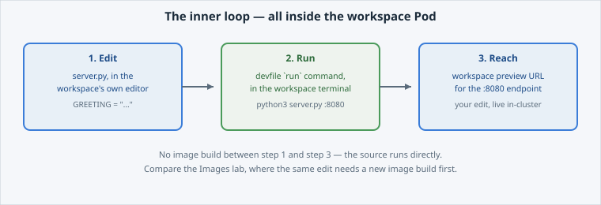

Everything so far, the devfile, the workspace and the cloned source, exists so that you can
**edit code and run it inside the cluster in one step**, which is the thing a laptop cannot do
on an air-gapped platform.

Open the slide for this page (📊 **Slides** tab):

```dashboard:reload-dashboard
name: Slides
url: :///slides/#/inside
```


**📌 Two different terminals, do not mix them up.** Every other page in this course
used the **Educates terminal** (the one in this dashboard). From here on, "the
terminal" means the **workspace terminal**, a separate shell running *inside*
the Dev Spaces workspace Pod, with its own working directory (the cloned
`hello-dcs` repo). Commands typed there never touch this session's terminal, and
vice versa.


## The loop

Inside the workspace, three things happen in sequence:



1. **Edit.** Open `server.py` in the workspace's own editor and change the
   `GREETING` default, the same string **Deploy Your First App** taught you to change with
   `oc set env`, except here you are editing the *source*, not an environment
   variable on a running Deployment.
2. **Run.** Trigger the `run-hello-dcs` command from page 02's devfile — one
   click, or `python3 server.py` typed directly into the workspace terminal. It
   starts on port 8080, **inside the workspace container**, using the exact
   `commandLine` the devfile declared.
3. **Reach it.** Dev Spaces exposes the devfile's `endpoints` entry (`targetPort:
   8080`) as a workspace preview URL, click it, and your edited greeting is
   staring back at you, served from a process running inside your namespace.

## Three ways to get a code change running

- **`oc apply`** (**Deploy Your First App**) deploys an image somebody already built. You
  never touch source.
- **A BuildConfig** (**Build Your Image on DCS**) turns your source into a *new image* on
  every change. That is the production-shaped path, with a build cycle between editing a line
  and seeing it run.
- **A Dev Spaces workspace**, this lab, runs your source directly with no image build in
  between. It is the fastest inner loop, and it is meant for active development rather than
  for what ships.

None of them replaces another. A workspace is where you iterate, a BuildConfig turns the
result into a deployable image, and `oc apply` puts that image into a namespace. The next
page draws the boundary explicitly.

## Check your understanding

Why does editing `GREETING` in the workspace show up immediately when you run the
app, with no image build step, unlike **Build Your Image on DCS**?


**❓ Answer:** Because the workspace runs the source directly (`python3 server.py`)
from the cloned project on disk, there is no image to build. **Build Your Image on DCS**'s BuildConfig
exists precisely because a *deployed* Pod runs from a built image, not live
source; Dev Spaces trades that production-shaped path for the fastest possible
feedback loop while you are actively writing code.

