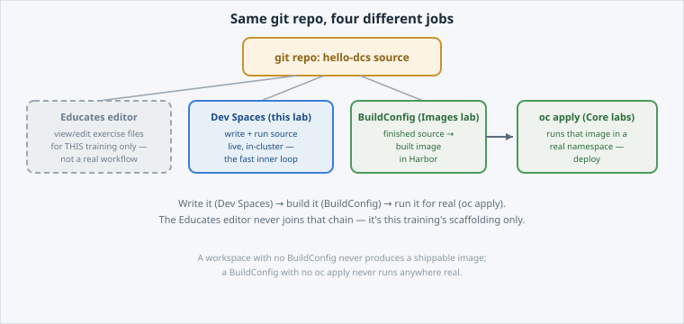

Four tools in this course touch your code, and they are easy to confuse. Each owns a
different job, and this page draws the line between them.

Open the slide for this page (📊 **Slides** tab):

```dashboard:reload-dashboard
name: Slides
url: :///slides/#/compare
```



## The Educates editor is not a real IDE

Every lab in this course, including this one, has given you a browser-based code
editor as part of the **workshop environment**, and that is how you have viewed and edited
exercise files. It is **not** a development environment your organisation runs day to day. It
exists for the duration of this training session, has no connection to your tenant's source
control, and disappears when the session ends.

A browser editor is not the same thing as a browser-based IDE that is part of the platform,
which is what Dev Spaces is.

## The four jobs

| Tool | Job | When you reach for it |
|---|---|---|
| **Educates editor** | View/edit exercise files *during this training* | Every lab — it is scaffolding, not a real workflow |
| **Dev Spaces** (this lab) | Write and run code, live, **inside the cluster** | Day-to-day development — the fast inner loop |
| **BuildConfig** (`lab-b02-build-your-image`) | Turn finished source into a deployable **image** | Once a change is ready to become a real artifact |
| **`oc apply`** (`lab-a01-deploy-first-app`, reinforced in `lab-b01-docker-to-k8s`) | Put a built image **into a running namespace** | Deploying (or promoting) that artifact |

The **same git repository** feeds all of them, each at a different point in the same
lifecycle: write it, build it, run it. None of them substitutes for another. A workspace with
no BuildConfig never produces a shippable image, a BuildConfig with no `oc apply` never runs
anywhere real, and `oc apply` needs something already built to point at.


**📌 Note:** the **operator** that runs Dev Spaces on your cluster is platform-managed, like
every other DCS-provided service. You consume Dev Spaces; you do not install or upgrade it.
That is the same ownership split the Operators lab covers in full.


## Check your understanding

A teammate says "I built my image, why do I need Dev Spaces at all?" What is the
honest answer?


**❓ Answer:** They do not need it for *that* build — BuildConfig (**Build Your Image on DCS**) already turned
finished source into an image, and `oc apply` (**Deploy Your First App**) already runs it. Dev
Spaces earns its keep **before** that point: while the code is still being
written, it is the fastest way to edit-and-run without waiting on an image build
for every change. Once the code is ready, the BuildConfig → `oc apply` path is
still the one that ships it.

