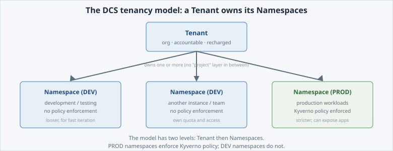

One more piece of vocabulary completes the model. Every namespace belongs to a **Tenant**.

Open the slide for this page (📊 **Slides** tab):

```dashboard:reload-dashboard
name: Slides
url: :///slides/#/tenancy
```

## Tenant → Namespaces

A [**Tenant**](/services/tenants) is the org-level unit on
. It is who is **accountable**, and it is what gets **billed**
(recharged).

A Tenant **owns one or more Namespaces**. The model has two levels, Tenant then
Namespaces:




**⚠️ There is no separate "project" layer.** On OpenShift, "project" is the word for
a namespace — the same thing you've been using — not a third level between Tenant and
Namespace. If you've seen a "Namespace → Project → Tenant" diagram elsewhere, it's wrong
for .


## DEV and PROD namespace types

Namespaces come in **types** — most importantly **DEV** and **PROD** — and they behave
differently:

- **PROD** — governed more strictly: policy enforcement, and the only place you are allowed
  to expose apps.
- **DEV** — looser, for fast iteration.

This lab only shows that the types exist. The **DEV vs PROD Namespaces** lab (Operate &
Observe track) shows how the difference is enforced.

Look at the labels on your own namespace. The command reads them and formats them one per
line:

```terminal:execute
command: oc get namespace "$(oc project -q)" -o jsonpath='{.metadata.labels}' | tr ',' '\n' | tr -d '{}"' | tee ~/exercises/ns-labels.txt
```

```section:begin
name: breakdown-namespace-labels
prefix: Breakdown
title: What each part of the command does
```

- **`oc get namespace "$(oc project -q)"`** — reads your own namespace object;
  `$(oc project -q)` inserts its name.
- **`-o jsonpath='{.metadata.labels}'`** — prints only the labels field, as one line of
  JSON.
- **`| tr ',' '\n'`** — `tr` replaces each comma with a line break, so each label gets its
  own line.
- **`| tr -d '{}"'`** — deletes the braces and quotes, so the output is easy to read.
- **`| tee ~/exercises/ns-labels.txt`** — shows the output in the terminal and also saves a copy to
  that file, so the check below can read it.

```section:end
name: breakdown-namespace-labels
```

```examiner:execute-test
name: verify-namespace-labels
title: Verify your namespace labels are readable
timeout: 10
```

The labels are how the platform tracks which Tenant a namespace belongs to and what type
it is.


**⚠️ Do not confuse a cluster with a namespace type.** From the **What is DCS?** lab: Sandbox and PROD are
*clusters* — where the platform runs. DEV and PROD here are *namespace types* — how a
namespace is governed. The two share the word "PROD" but mean different things.

