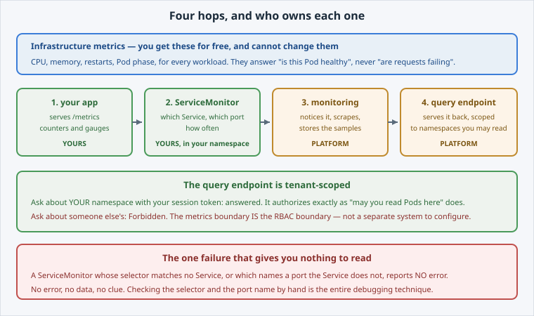

Two kinds of metric exist on this cluster, and they are easy to confuse.

Open the slide for this page (📊 **Slides** tab):

```dashboard:reload-dashboard
name: Slides
url: :///slides/#/pipeline
```



## Infrastructure metrics: free, and generic

The platform collects CPU, memory, restarts and Pod phase for **every** workload. You get
them without doing anything, and you cannot change them.

They answer "is this Pod healthy", and nothing about whether your app is doing its job.

## Application metrics: yours, and opt-in

Requests per second, failed logins, queue depth: nobody but your app can produce these.

The path has four hops, and each one has an owner:

1. **Your app** exposes numbers on an HTTP endpoint, by convention `/metrics`. *(You.)*
2. A **ServiceMonitor** says which Service to scrape and how often. *(You, in your namespace.)*
3. The platform's **user-workload monitoring** notices it and starts scraping. *(Platform.)*
4. A **query endpoint** serves it back, scoped to namespaces you may read. *(Platform.)*

You own the two ends. The platform owns the middle, and you never configure Prometheus
yourself.


**📌 Note:** this only works because the platform runs **user-workload monitoring**. On a
cluster without it, nothing acts on a ServiceMonitor.


## Check the app you are about to instrument

```terminal:execute
command: envsubst < deployment.yaml | oc apply -f - && oc apply -f service.yaml && oc rollout status deploy/hello-dcs --timeout=180s
```

```section:begin
name: breakdown-deploy-app
prefix: Breakdown
title: What each part of the command does
```

- **`envsubst < deployment.yaml`** — reads the file and replaces `${DCS_REGISTRY}` with its value from your session, so the registry host is not hard-coded.
- **`| oc apply -f -`** — the pipe hands that output to `oc apply`; `-f -` means "read the manifest from the pipe" instead of from a file.
- **`&&`** — runs the next command only if `oc apply` succeeded.
- **`oc apply -f service.yaml`** — creates the Service in front of the Pods.
- **`&&`** — again, continues only if that succeeded.
- **`oc rollout status deploy/hello-dcs --timeout=180s`** — waits until the Deployment's Pods are ready, or gives up after 180 seconds.

```section:end
name: breakdown-deploy-app
```

```examiner:execute-test
name: verify-app-ready
title: Verify the app is running behind a Service
timeout: 90
retries: .INF
delay: 3
```

Two replicas, and a Service with a **named** port — both matter on the next pages.
