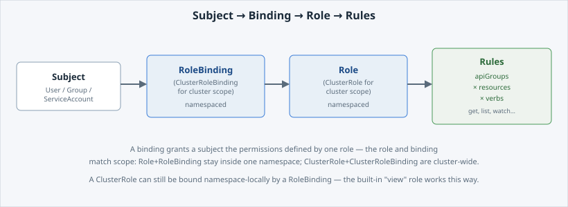

`can-i` answers instantly because [Kubernetes RBAC](https://kubernetes.io/docs/reference/access-authn-authz/rbac/)
computed it from four kinds of object. Read them in order and the answer is no longer
opaque.

Open the slide for this page (📊 **Slides** tab):

```dashboard:reload-dashboard
name: Slides
url: :///slides/#/objects
```

## Four object types, two scopes

- A **Role** grants permissions **inside one namespace**. A **ClusterRole** grants the same
  kind of permissions **cluster-wide**, and can also be bound namespace by namespace when the
  same permission set is needed in several places. The built-in `view` role you inspect below
  works that way.
- A **RoleBinding** grants a Role or a ClusterRole to a subject **inside one namespace**. A
  **ClusterRoleBinding** grants a ClusterRole to a subject **cluster-wide**.
- A **rule**, inside a Role or ClusterRole, is a grant expressed as **apiGroups × resources ×
  verbs**: for example, on the core API group, for `pods`, allow `get`, `list` and `watch`.
- A **subject** is who the binding names: a **User**, a **Group**, or a **ServiceAccount**,
  which is a non-human identity used by workloads and automation.

Put together, the chain that produces every `can-i` answer looks like this:




**📌 Note:** on , tenants manage Roles and RoleBindings **within
their own namespaces**. ClusterRoles and ClusterRoleBindings are platform-managed and
read-only to tenants. You can inspect them, as below, but you cannot create cluster-scoped
RBAC objects.


## Read a built-in ClusterRole

`view` is a built-in ClusterRole shipped with every cluster, and it is a ready-made
read-only rule set. Read its rules:

```terminal:execute
command: oc describe clusterrole view
```

```examiner:execute-test
name: verify-clusterrole-view
title: Verify the view ClusterRole's rules are readable
timeout: 10
```

Scan the output for the `PolicyRule` table: a `Verbs` column showing `get`, `list` and
`watch` against a wide range of `Resources`, and never `create`, `update`, `delete` or
`patch`. That is what read-only looks like as a rule set.

## Find the binding that grants you access

You have not created any RBAC objects, but you already have `admin`-level access to your own
namespace, from a RoleBinding the platform created for you. List the RoleBindings in your
namespace:

```terminal:execute
command: oc get rolebindings -o wide
```

`-o wide` adds extra columns to the default table, here the bound `Subjects`, so you can see
who each binding applies to without a separate `describe`.

```examiner:execute-test
name: verify-rolebindings-listed
title: Verify at least one RoleBinding is listed
timeout: 10
```

You should see at least one RoleBinding, the one connecting your own identity to a role in
this namespace. Now trace it in full:

```terminal:execute
command: oc describe rolebinding $(oc get rolebindings -o jsonpath='{.items[0].metadata.name}')
```

```examiner:execute-test
name: verify-rolebinding-described
title: Verify the RoleBinding's subject and role reference are traced
timeout: 10
```

Two sections matter. **`Role`** near the top names the Role or ClusterRole it grants, and
**`Subjects`** lists who it grants it to, by kind (`User`, `Group` or `ServiceAccount`), name
and namespace.

That is the whole chain: this subject, this binding, this role, these rules. It is what
produced every `yes` and `no` on the last page. Next you build the same chain yourself, for a
subject you create.

- [Kubernetes RBAC reference](https://kubernetes.io/docs/reference/access-authn-authz/rbac/)
- [OpenShift default cluster roles](https://docs.openshift.com/container-platform/latest/authentication/using-rbac.html)
