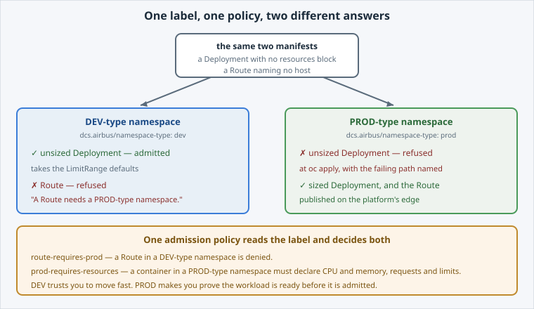

Both of your lab namespaces run the same Kubernetes, on the same cluster, with the same
image registry.

What separates them is a **label**, and the policy that reads it.

Open the slide for this page (📊 **Slides** tab):

```dashboard:reload-dashboard
name: Slides
url: :///slides/#/types
```



## Look at the two you were given

```terminal:execute
command: oc get namespace $DEV_NS $PROD_NS --show-labels
```

Read the `dcs.airbus/namespace-type` label: one says `dev`, the other `prod`. That label is
the entire technical difference between them.

```examiner:execute-test
name: verify-both-namespaces
title: Verify both lab namespaces exist, one of each type
timeout: 30
retries: .INF
delay: 3
```

## The policy that reads it

The platform runs an **admission policy** that matches on that label. It is a cluster-scoped
object, and you cannot read it:

```terminal:execute
command: oc auth can-i list clusterpolicies
```

```examiner:execute-test
name: verify-policy-not-readable
title: Verify the platform's policy is not yours to read
timeout: 30
retries: .INF
delay: 3
```

You get **`no`**, as expected. The platform owns this policy, so you cannot read, edit or
bypass it. You can only see its decisions, and the rest of this lab does that.

Two rules are in play:

- **`route-requires-prod`** refuses a Route in a DEV-type namespace.
- **`prod-requires-resources`** requires a container in a PROD-type namespace to declare CPU
  and memory requests **and** limits.


**📌 This is a representative slice, not the whole DCS posture.** Real PROD namespaces carry
more rules than these two. These are the two that can be demonstrated end to end inside a
training session, and they are real: the refusals come from the cluster's admission path, and
each one names the rule that produced it.


## Why the split exists

- **DEV** lets you move fast. Deploy something half-finished, iterate, break it.
- **PROD** requires the workload to be sized before it is admitted, so it can be scheduled and
  accounted for against a budget.

On one cluster, DEV is for iterating and PROD refuses unfinished work at admission.

Next, use the DEV namespace as intended.
